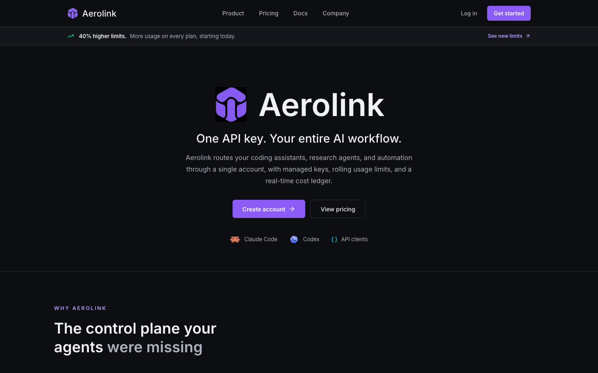
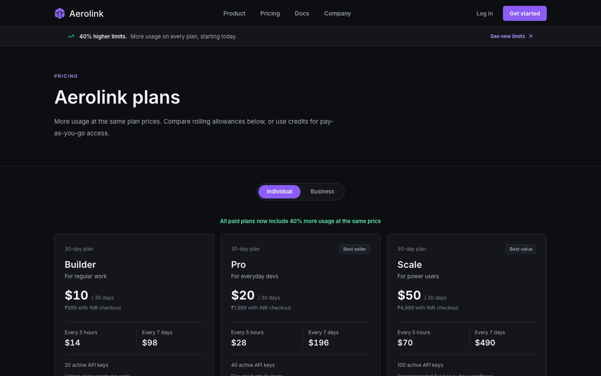
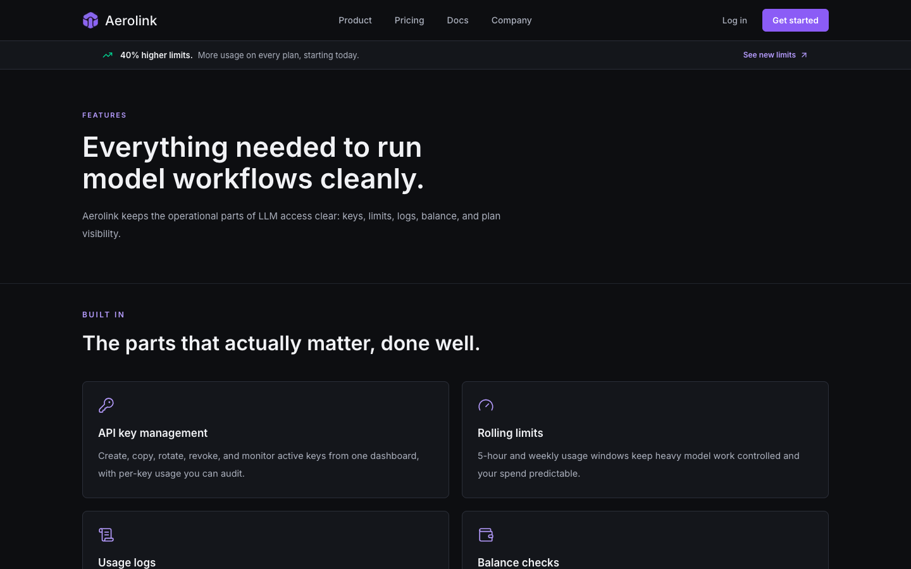

# AeroLink Review: Is the $10 Builder Plan Worth It for Claude Code and Codex?

AeroLink takes a different approach from model marketplaces with hundreds of cards. It is built around **coding agents and repeatable developer workflows**: one account for Claude Code, Codex and API clients, multiple keys, rolling usage limits, and a request-level cost ledger.

[Check AeroLink plans and create an account](https://aerolink.lat/register?ref=WSF8ZBY)

## The short verdict

Start with **Builder at $10 for 30 days** if you want to test a managed relay for regular coding. Move to Pro only after your own logs show that the five-hour window is too small. AeroLink is most compelling for developers who work with agents every day; occasional users should compare its separate credits option with pay-as-you-go relays.

## Plans: Builder vs Pro vs Scale

| Plan | 30-day price | 5-hour allowance | 7-day allowance | Active API keys | Best fit |
|---|---:|---:|---:|---:|---|
| Builder | $10 | $14 | $98 | 20 | First month, one developer |
| Pro | $20 | $28 | $196 | 40 | Daily agent use |
| Scale | $50 | $70 | $490 | 100 | Several projects or agents |

The five-hour limit matters more than the headline monthly price. Coding-agent work is bursty: one repository-wide task can consume far more in an afternoon than several days of short edits. Pick the lowest plan that still covers your busiest work session.

AeroLink also lists credits separately from subscriptions. Subscriptions suit predictable daily work; credits may fit irregular usage. Compare both at checkout rather than treating the monthly allowance as cash balance.

## Sign-up, payment and setup

1. Create an account and verify the email address.
2. Open Pricing and select an individual plan.
3. Choose the checkout currency and payment option shown for your region.
4. After activation, create a limited key for one client.
5. Set AeroLink's base URL and key in Claude Code or Codex.
6. Run a small repository task and inspect the request ledger.

Do not begin with a long autonomous run. First confirm streaming, tool calls, model routing and the allowance deduction. Then use the same key for a normal working day.

## Claude Code and Codex strategy

Use separate keys for Claude Code and Codex. Claude Code needs the Anthropic-compatible message flow, streaming and tool use; Codex needs the OpenAI-compatible route used by your configuration. Separate keys make it easy to compare weekly cost and revoke one client without disrupting the other.

## AeroLink versus a general API relay

Choose AeroLink when coding agents are the main workload and rolling limits make sense. Choose a broad pay-as-you-go marketplace when you constantly switch among image, audio and many unrelated text models. AeroLink's strength is operational control, not the longest model catalog.

## Who should buy it?

- Developers using Claude Code or Codex most workdays;
- Small teams that need keys per member, project or CI job;
- Agent users who want request status, tokens, latency and estimated cost together;
- Buyers willing to start at $10 and upgrade from real usage data.

It is less attractive for a few calls per month, workloads that spike beyond a rolling window, or organizations requiring direct vendor contracts.

## FAQ

### Is Builder enough for one developer?
For light and moderate coding, it is the sensible starting point. Upgrade only if the five-hour or weekly window repeatedly interrupts normal work.

### Can one account serve Claude Code and Codex?
Yes. Give each client its own key and verify the protocol-specific workflow before a long run.

### Should I buy credits or a plan?
Use a plan for regular daily work and compare credits for irregular usage. Your busiest week is a better guide than an average monthly estimate.

[Start with AeroLink Builder and measure one real work week](https://aerolink.lat/register?ref=WSF8ZBY)
